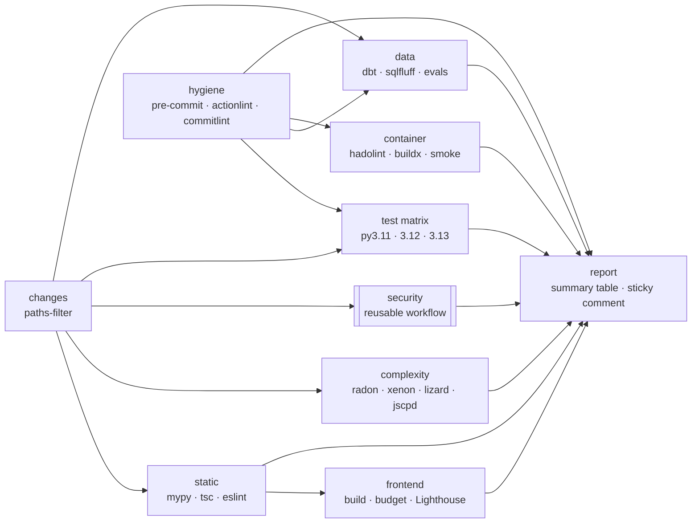

# CI/CD pipeline

Every push to `main` and every pull request runs a multi-stage GitHub Actions pipeline. Each gate is a real check
that passes on this repo today. Existing debt is recorded in **ratchet baselines**: it may shrink but never grow.



Other workflows: `codeql.yml` (Python, JS/TS and Actions, weekly and on PRs), `scorecard.yml` (OpenSSF, on `main` and weekly),
`pr-title.yml` (Conventional Commit PR titles) and `release-please.yml` (release PR and changelog on `main`, nothing published).

## Design principles

| Principle | How |
|---|---|
| Least privilege | Top-level `permissions: contents: read`; jobs opt in to `pull-requests: write` or `security-events: write` |
| Supply chain | Every third-party action pinned to a full commit SHA (with a version comment); Dependabot keeps them fresh |
| Fast feedback | `concurrency` cancels superseded runs; `paths-filter` skips backend or frontend jobs that a change cannot affect |
| Caching | uv cache (keyed on `requirements*.txt`), npm cache (lockfile), pre-commit cache, buildx `type=gha` layer cache |
| Reuse | Composite actions `.github/actions/setup-python-env` and `setup-node-env`; reusable `_security.yml` |
| Bounded | Every job has a `timeout-minutes` |

## Stages

### Routing: `changes`

`dorny/paths-filter` classifies the diff as `backend`, `frontend`, `docs` or `ci`. On a PR, the test and data jobs are skipped
when no backend or CI file changed, and the frontend job is skipped when no frontend or CI file changed. A push to `main` always runs everything.

### Stage 1: hygiene

- **pre-commit** (`.pre-commit-config.yaml`, the same hooks developers run locally): ruff lint and format, prettier (TS/CSS/YAML/JSON),
  markdownlint-cli2, shellcheck, editorconfig-checker, end-of-file and whitespace fixers, yaml/json/toml syntax, merge-conflict markers,
  large files, private keys.
- **actionlint** on all workflows (with shellcheck on `run:` blocks).
- **commitlint**: every commit in the PR follows Conventional Commits (`commitlint.config.mjs`). `pr-title.yml` checks the PR title.

### Stage 2: static analysis

- **mypy** through `scripts/ci/mypy_ratchet.sh`: errors listed in `.ci/mypy-baseline.txt` are tolerated and new ones fail. The baseline is empty today.
- **tsc --noEmit** (strict TS project references).
- **ESLint** with a warning budget (`--max-warnings 70`). `no-explicit-any` is a warning, not an error, because API payloads are still typed loosely (68 today).
  Lower the budget as types land.

### Complexity

`scripts/ci/complexity_gate.py` combines radon (Python cyclomatic complexity and maintainability index) and lizard (TypeScript):

| limit | value |
|---|---|
| cyclomatic complexity per function | ≤ 15 |
| maintainability index per module | ≥ 10 |
| file length | ≤ 600 lines |
| function length | ≤ 120 lines |

Pre-existing violators are listed in `.ci/complexity-baseline.json`. They may not get worse (a 5-point MI slack absorbs formatting noise),
and new code must meet the limits. Regenerate the baseline with `--update` only after an intentional refactor.
Also checked: xenon average rank ≤ B and jscpd duplication ≤ 3%. The markdown report goes to the job summary and an artifact.

### Security (`_security.yml`)

| check | gate |
|---|---|
| gitleaks over full git history | any finding |
| bandit SAST | medium+ (skips are justified in `pyproject.toml`) |
| pip-audit on `requirements.txt` | any known CVE |
| `npm audit` | high+ |
| Trivy filesystem (vuln, secret, misconfig) | HIGH/CRITICAL with a fix available |
| SBOM (syft, CycloneDX JSON) | artifact `sbom-cyclonedx.json` |
| dependency-review (PRs) | new dependency with a high+ advisory |

### Tests

pytest on Python 3.11, 3.12 and 3.13 (`fail-fast: false`). `scripts/setup.sh` runs first: it clones `jaffle_shop_duckdb` and builds the
"prod" warehouse that the tool tests query through the dbt adapter. Coverage (line + branch) must stay at or above `.ci/coverage-threshold`
(48%; measured 52%). On PRs, **diff-cover** requires ≥ 80% coverage on changed lines; bulk PRs touching more than 500 Python lines (e.g. a mass reformat) get a report but are not blocked, since the global gate still applies. JUnit XML and coverage.xml are uploaded and summarised.

### Data

- `dbt parse` and `dbt compile` on the demo project.
- **sqlfluff** on `examples/sql/` (the reference SQL the mock agent writes, linted with `examples/sql/.sqlfluff`).
  The vendored jaffle_shop models are third-party and not linted.
- **Evals in mock mode**: the API starts with `FACTORY_MOCK=1`, all six seeded cases run, and `scripts/ci/eval_gate.py` compares each
  pass/fail with `evals/expected.yml`. Three cases are *meant* to fail, because the mock solution falls into the trap (fan-out, null handling,
  month boundary). If any case flips, the scorer or the gates regressed. The scorecard goes to the job summary and the JSON is uploaded.

### Frontend

The Vite production build runs first. A **bundle budget** then checks gzip size (`scripts/ci/bundle_budget.py`: JS ≤ 90 KB, CSS ≤ 15 KB)
and the `dist/` artifact is uploaded. **Lighthouse CI** runs on the static build for information only (`continue-on-error`).

### Container

The multi-stage `Dockerfile` builds the UI with node, resolves deps with uv in a builder stage and ships a `python:3.12-slim` runtime that
runs as UID 10001 with a `HEALTHCHECK`. CI lints it with **hadolint**, builds it with **buildx** and the GitHub Actions cache (never pushed),
then smoke-tests it: the UID must be non-root and `/api/health` must answer.

### Report

The `report` job always runs. It renders one table of every gate's result into `$GITHUB_STEP_SUMMARY`, keeps a sticky comment
updated on same-repo PRs, and fails if any upstream gate failed or was cancelled. Jobs skipped by the path filter count as passing.

## Running locally

```bash
pip install -r requirements-dev.txt && pre-commit install   # hooks on every commit
pre-commit run --all-files
scripts/ci/mypy_ratchet.sh
python scripts/ci/complexity_gate.py --report /tmp/complexity.md
pytest --cov --cov-fail-under="$(cat .ci/coverage-threshold)"
(cd frontend && npx tsc -b --noEmit && npx eslint . --max-warnings 70 && npm run build) && python scripts/ci/bundle_budget.py
```

## Repository settings

- **Branch protection on `main`**: require `Report`, `PR title`, and the `CodeQL` checks.
- **Release PRs**: release-please needs *Settings → Actions → General → Allow GitHub Actions to create and approve pull requests*.
- **Scorecard publishing**: uses OIDC (`id-token: write`). No secrets are required anywhere in the pipeline.
